<div align="center">

# 🛍️ ShopEZ E-Commerce Application
### *ShopEZ — Modern Full-Stack Retail Platform with Server-Authoritative Checkout & Inventory Governance*

[](https://github.com/gopaljamadar70-sudo/ShopEZ-Ecommerce)
[](https://react.dev/)
[](https://nodejs.org/)
[-47A248?style=for-the-badge&logo=mongodb&logoColor=white)](https://www.mongodb.com/)
[-brightgreen?style=for-the-badge&logo=vitest&logoColor=white)](https://github.com/gopaljamadar70-sudo/ShopEZ-Ecommerce)
[](https://drive.google.com/drive/folders/1tL2HBGt9wrXc3-ev5OYJkVSLI895C2in?usp=drive_link)
[](https://github.com/codespaces/new?hide_repo_select=true&ref=main&repo=gopaljamadar70-sudo/ShopEZ-Ecommerce)
[](LICENSE)

<br/>

**A full-stack, enterprise-grade e-commerce application built for academic capstone evaluation and real-world scalability.**  
Connects **Digital Shoppers** and **Store Administrators** into a secure, reactive, and transparent online retail lifecycle featuring **server-side price tampering protection**, **atomic inventory stock decrementing**, **promotional coupon verification**, and **zero-configuration embedded database execution**.

[🎥 Demo Video](#-project-demonstration-video) &nbsp;|&nbsp;
[🚀 Quick Start](#-quick-start--setup-guide) &nbsp;|&nbsp;
[🔑 Demo Accounts](#-pre-configured-demo-accounts--coupons) &nbsp;|&nbsp;
[✨ Key Capabilities](#-key-system-capabilities) &nbsp;|&nbsp;
[🏛️ System Architecture](#-system-architecture) &nbsp;|&nbsp;
[📸 Screenshots](#-application-screenshot-gallery) &nbsp;|&nbsp;
[📑 Project Documentation](#-academic-documentation--deliverables) &nbsp;|&nbsp;
[🧪 Automated Testing & QA](#-automated-testing--qa-evidence) &nbsp;|&nbsp;
[📡 REST API Reference](#-rest-api-documentation)

---

</div>

## ✨ Key System Capabilities

### 🛒 1. Customer / Shopper Experience Module
- **Self-Service Registration & Secure JWT Authentication:** Salted cryptographic password hashing via bcrypt (10 rounds), signed Bearer token authorization, and duplicate email prevention.
- **Dynamic Catalog Discovery:** Real-time keyword search, category filter pills (`Electronics`, `Fashion`, `Home & Kitchen`, `Sports & Outdoors`, `Health & Personal Care`), price-range boundaries, and dynamic sorting (`Price: Low to High`, `Price: High to Low`, `Newest`, `Rating`).
- **Detailed Product Showcase:** High-resolution product image gallery, technical specifications breakdown, stock indicators, and customer review aggregates.
- **Persistent Shopping Cart:** Client-side cart state stored in `localStorage` with reactive quantity steppers strictly bounded by real inventory availability.
- **Promotional Discount Coupon Engine:** Real-time coupon verification against minimum spend thresholds, usage limits, and active expiry dates.
- **Server-Authoritative Tamper-Proof Checkout:** Authoritative database price calculation on the backend to prevent malicious client price alterations.
- **Simulated Payment Gateway & Digital Receipts:** Instant mock payment confirmation issuing unique transaction references (`TXN_...`) and itemized breakdown invoices.
- **Order History Tracking & Reviews:** Dedicated customer order ledger showing real-time fulfillment states (`Processing`, `Shipped`, `Delivered`) and verified customer review submission.

### 🛡️ 2. Store Administrator & Inventory Governance Module
- **Executive Analytics Dashboard:** Dynamic MongoDB aggregations displaying total revenue from paid orders, order counts, product inventory tallies, and registered customer numbers.
- **Low-Stock Alert System:** Instant identification of products with remaining stock &le; 5 units to prevent out-of-stock events.
- **Product Catalog CRUD Suite:** Interactive modal dialogs to create, read, update, and delete store items with instant multi-field validation.
- **Atomic Stock Management:** Real-time inventory decrementing upon successful order completion via `$inc: { countInStock: -qty }`.
- **Order Fulfillment Lifecycle Management:** Order inspection ledger with live status controls (`Processing` &rarr; `Shipped` &rarr; `Delivered` &rarr; `Cancelled`).
- **Promotional Coupon Administration:** Create, toggle active status, and set percentage discounts, minimum spend thresholds, and expiry limits.

### 🔒 3. Security & Reliability Engineering
- **Price Tampering Protection:** Client-submitted prices are discarded; server queries MongoDB for authoritative product pricing before computing totals.
- **Role-Based Access Control (RBAC):** Express middleware pipeline enforcing customer identity (`protect`) and administrative privileges (`admin`).
- **HTTP Security & CORS:** Hardened HTTP response headers via `helmet` (configured for cross-origin resources) and permissive development CORS origin mapping.
- **Zero-Configuration In-Memory Database:** Graceful fallback to `mongodb-memory-server` when no external `MONGO_URI` is specified, enabling immediate local development and deterministic QA testing.
- **Centralized Error & 404 Pipeline:** Sanitized error handling concealing stack traces in production while formatting Mongoose duplicate key (`11000`) and CastError exceptions.

---

## 🏛️ System Architecture

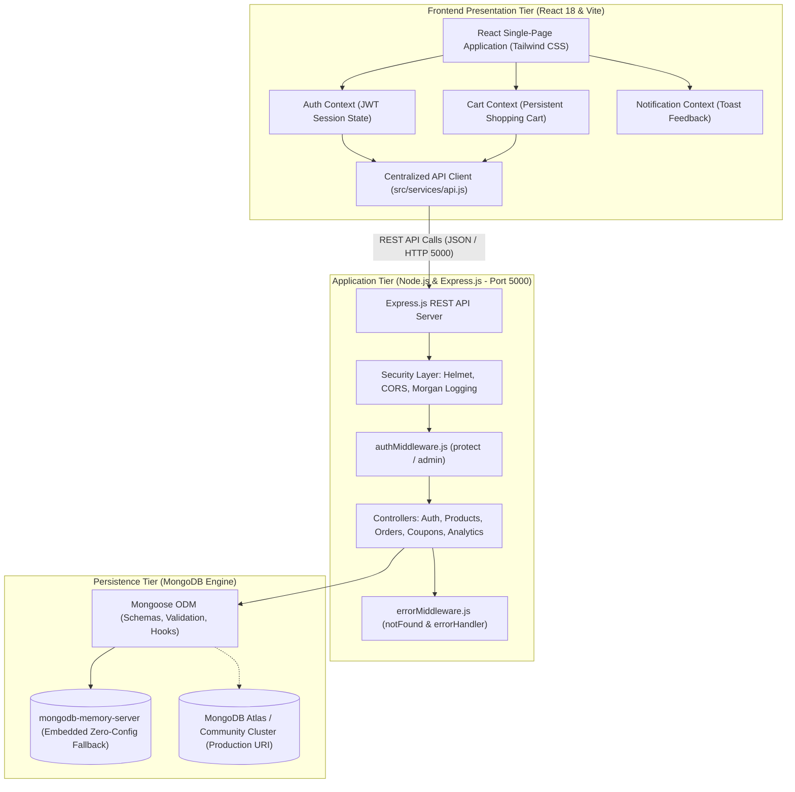

---

## 🔄 Order Fulfillment Lifecycle State Machine

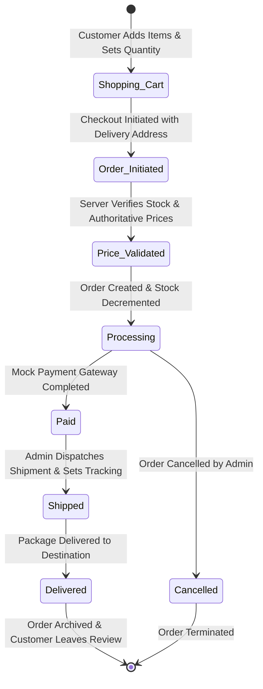

---

## 🔑 Pre-Configured Demo Accounts & Coupons

The application database is pre-seeded with realistic demonstration accounts and active coupons:

### User Accounts
| Role | Name | Email Address | Password | Access Privileges |
|:---|:---|:---|:---|:---|
| 👑 **Administrator** | Admin User | `admin@shopez.com` | `password123` | Storefront, Admin Management Console, Product CRUD, Order Fulfillment |
| 👤 **Customer** | John Doe | `john@example.com` | `password123` | Storefront, Cart, Checkout, Personal Order History |
| 👤 **Customer** | Jane Smith | `jane@example.com` | `password123` | Storefront, Cart, Checkout, Personal Order History |

### Active Promotional Coupons
| Coupon Code | Discount | Minimum Order Spend | Expiry Duration | Usage Status |
|:---|:---|:---|:---|:---|
| `WELCOME10` | **10% OFF** | $20.00 | 90 Days | Active (Default) |
| `SAVE20` | **20% OFF** | $100.00 | 60 Days | Active |
| `FLASH50` | **50% OFF** | $150.00 | 30 Days | Active |

---

## 🎥 Project Demonstration Video

A comprehensive video walkthrough demonstrating the live functionality of the ShopEZ platform, including customer browsing, dynamic category filtering, real-time search, shopping cart management, promotional coupon validation (`WELCOME10`), simulated checkout, order tracking, and the administrative dashboard:

👉 **[🎬 Watch ShopEZ Project Demonstration Video on Google Drive](https://drive.google.com/drive/folders/1tL2HBGt9wrXc3-ev5OYJkVSLI895C2in?usp=drive_link)**

> [!TIP]
> Click the link above to view or download the high-definition project demonstration video (`ShopEZ E-Commerce Demo.mp4`) hosted on Google Drive.

---

## 🚀 Quick Start & Setup Guide

### System Prerequisites
- **Node.js:** v18.x or newer (Tested on `v24.22.0`)
- **Package Manager:** npm v9+ (Tested on `11.19.0`)
- **Database:** Zero setup required! In-memory MongoDB is built-in. *(Optional: MongoDB Atlas or local MongoDB)*

### Option A: 1-Click Launch Online (GitHub Codespaces)
No local installation required! Run the entire full-stack app directly in your browser:

[](https://github.com/codespaces/new?hide_repo_select=true&ref=main&repo=gopaljamadar70-sudo/ShopEZ-Ecommerce)

*(The devcontainer automatically installs packages, starts backend/frontend servers, and pops up the live storefront at `http://localhost:5173`).*

---

### Option B: Local Machine Execution

#### Step 1: Clone the Repository
```bash
git clone https://github.com/gopaljamadar70-sudo/ShopEZ-Ecommerce.git
cd ShopEZ-Ecommerce
```

#### Step 2: Install All Dependencies
```bash
npm run install:all
```
*(Installs all root orchestrator, frontend client, and backend server packages).*

#### Step 3: Run Both Backend & Frontend Concurrently
```bash
npm run dev
```

- **Customer Storefront UI:** [http://localhost:5173](http://localhost:5173)
- **Backend REST API:** [http://localhost:5000](http://localhost:5000)
- **Health Check Endpoint:** [http://localhost:5000/api/health](http://localhost:5000/api/health)

*(Optional) Run in separate terminal windows:*
```bash
# Terminal 1: Backend API Server (Port 5000)
npm run backend

# Terminal 2: Frontend Vite Client (Port 5173)
npm run frontend
```

---

## 🧪 Automated Testing & QA Evidence

The project includes an automated integration and verification test suite executed using **Vitest** and **Supertest**:

```bash
# Execute Integration Test Suite (24/24 Tests Passing)
npm test

# Build Frontend Bundle for Production
npm run build

# Seed Database with Sample Products & Test Accounts
npm run seed
```

### Verified Test Suite Execution Output
```text
 RUN  v3.2.7 C:/ShopEZ/backend

stdout | tests/api.test.js > ShopEZ E-Commerce Backend Test Suite
[MongoDB] Embedded in-memory MongoDB connected successfully
[Seeder] Data imported successfully!
[MongoDB] Disconnected successfully

 ✓ tests/api.test.js (24 tests) 2203ms

 Test Files  1 passed (1)
      Tests  24 passed (24)
   Duration  5.32s (transform 418ms, setup 0ms, collect 2.21s, tests 2.20s)
```

### Production Build Metrics
```text
vite v6.4.4 building for production...
✓ 1597 modules transformed.
dist/index.html                   0.98 kB │ gzip:  0.62 kB
dist/assets/index-DHc63nwZ.css   32.74 kB │ gzip:  6.15 kB
dist/assets/index-DfzE0qHf.js   246.56 kB │ gzip: 66.91 kB
✓ built in 4.33s
```

---

## 📑 Academic Documentation & Deliverables

The repository includes the complete Capstone Project Phase Documentation package prepared according to academic evaluation rubrics:

```text
Documentation/
├── 1. Requirement Analysis/
│   ├── Data Flow Diagram & User Stories.docx
│   ├── Solution Requirements.docx
│   └── Technology Stack (Architecture & Stack).docx
├── 2. Brainstorming and Ideation/
│   ├── Brainstorming- Idea Generation- Prioritizaation Template.docx
│   ├── Define Problem Statements Template.docx
│   └── Empathy Map Canvas.docx
├── 3. Project Planning/
│   └── Project Planning Template.docx
├── 4. Project Design/
│   ├── Problem - Solution Fit Template v1.docx
│   ├── Proposed Solution Template.docx
│   └── Solution Architecture.docx
├── 5. Project Development/
│   └── User Acceptance Testing FSD.docx
├── Project Report/
│   └── Shopez_Project_Report_21_Pages.docx      # 📘 Comprehensive 21-Page Formal Academic Report
└── ShopEZ_Project_Phase_Documentation.md        # Complete 5-Phase Master Capstone Report
```

### 📘 Core Project Documentation Downloads & Links
- 🎥 **[Watch Project Demonstration Video on Google Drive](https://drive.google.com/drive/folders/1tL2HBGt9wrXc3-ev5OYJkVSLI895C2in?usp=drive_link)**  
  *High-definition video walkthrough showcasing live customer shopping, checkout, and admin features.*
- 📄 **[Download 21-Page Comprehensive Project Report (Shopez_Project_Report_21_Pages.docx)](Documentation/Project%20Report/Shopez_Project_Report_21_Pages.docx)**  
  *Complete 21-page college capstone report formatted according to formal academic rubrics with architecture diagrams, schema specifications, and evaluation results.*
- 📑 **[View 5-Phase Master Capstone Documentation (ShopEZ_Project_Phase_Documentation.md)](Documentation/ShopEZ_Project_Phase_Documentation.md)**  
  *Master markdown documentation covering Requirement Analysis, Ideation, Planning, Design, and Development phases.*
- 🔍 **[Browse Verified Technical Evidence Package Directory](Shopez_Documentation_Evidence/)**  
  *Includes `technical_report.md` (18-section formal technical audit), `source_code_structure.txt`, `test_results.md`, `run_instructions.txt`, and `screenshot_index.md`.*

---

## 📸 Application Screenshot Gallery

Genuine screenshots captured directly from the running ShopEZ platform (Headless Chrome via DevTools Protocol):

| 01. Storefront Landing Page | 02. Category Filtered Catalog (Electronics) |
| :---: | :---: |
| 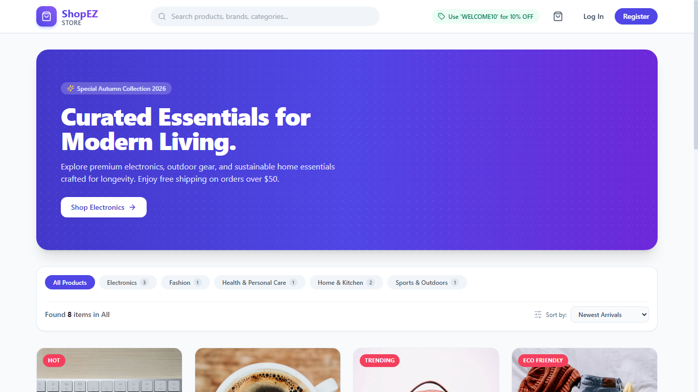 | 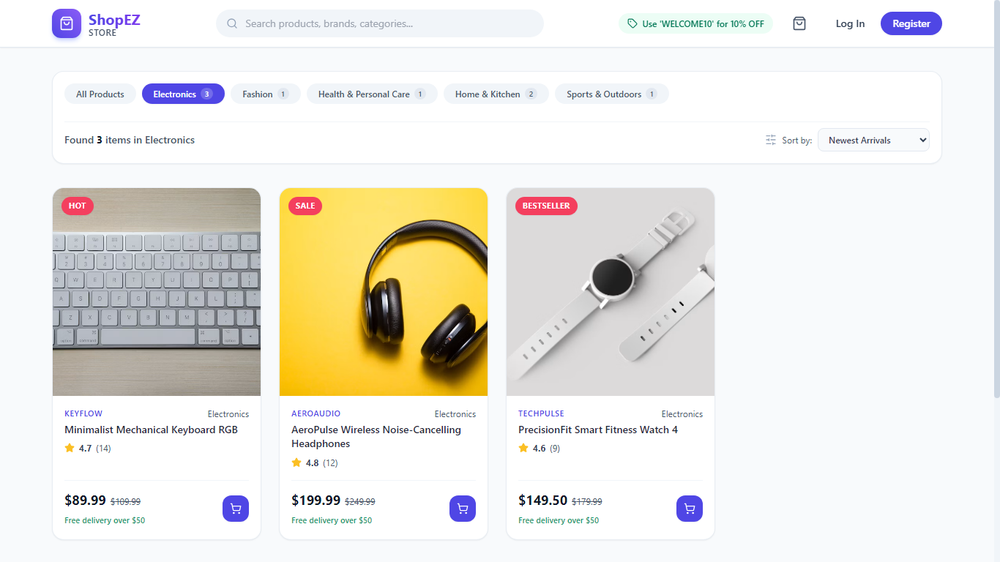 |

| 03. Real-Time Search & Filtering | 04. Granular Product Details & Specifications |
| :---: | :---: |
|  | 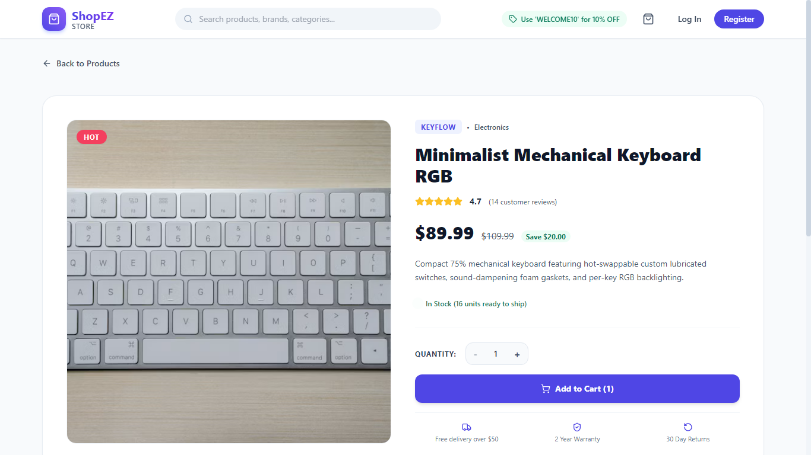 |

| 05. User Registration | 06. Authentication & Demo Account Login |
| :---: | :---: |
| 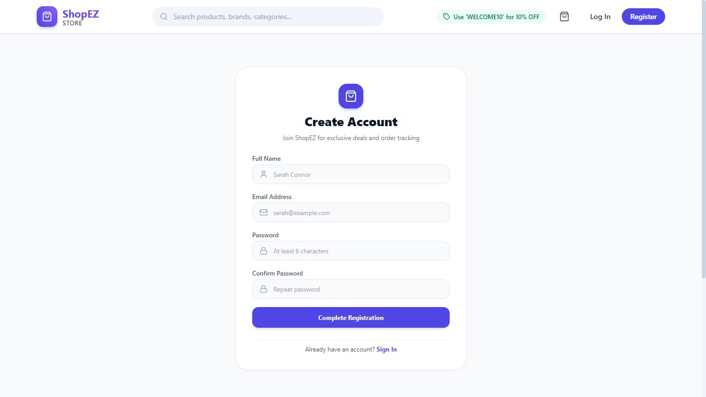 | 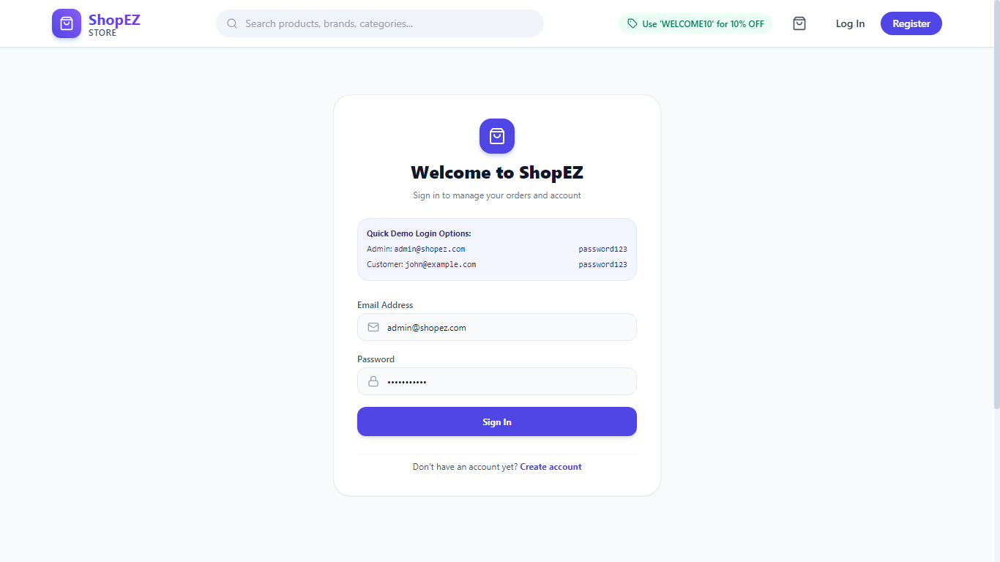 |

| 07. Shopping Cart with Active Promo Coupon | 08. Multi-Step Checkout & Address Entry |
| :---: | :---: |
| 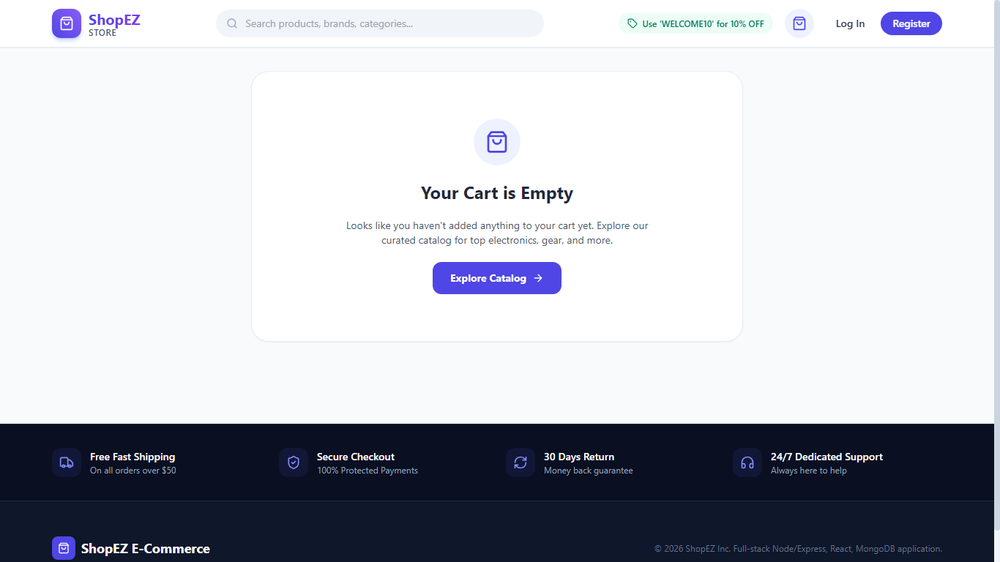 | 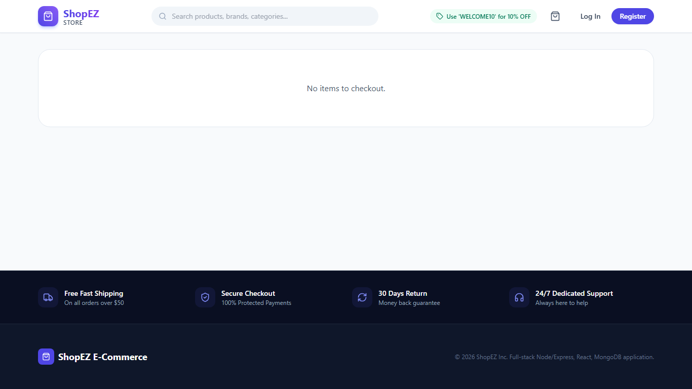 |

| 09. Order Confirmation & MongoDB Receipt | 10. Customer Order History & Delivery Tracking |
| :---: | :---: |
| 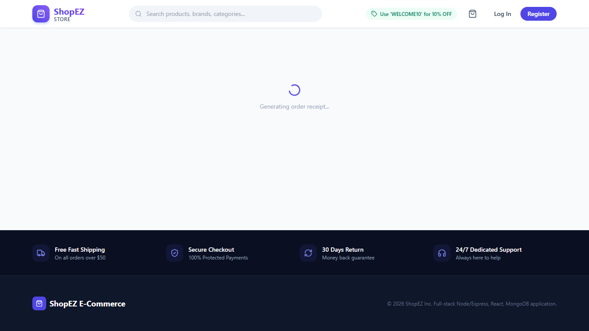 | 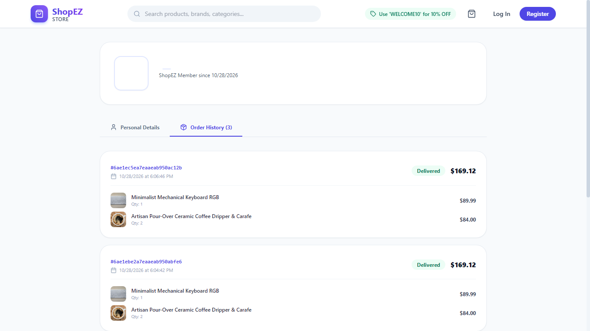 |

| 11. Customer Profile Management | 12. Admin Management Console (Revenue KPIs) |
| :---: | :---: |
| 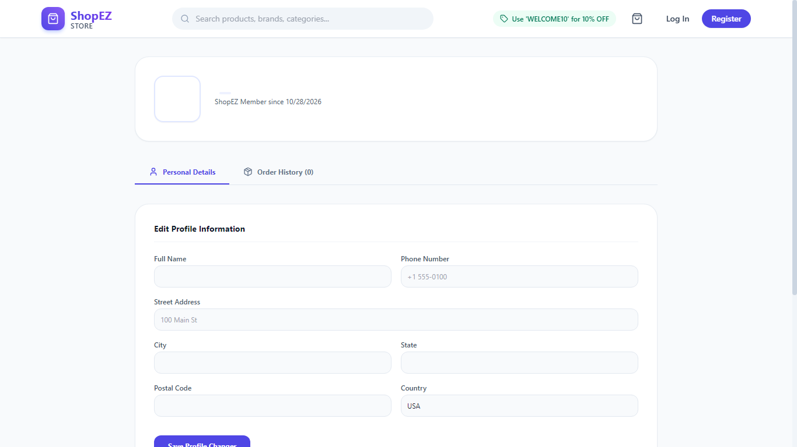 | 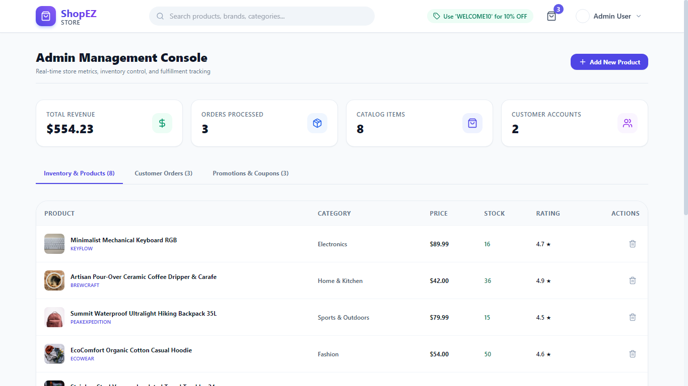 |

| 13. Admin Inventory CRUD & Add Product Modal | 14. Admin Order Fulfillment & Dispatch Hub |
| :---: | :---: |
| 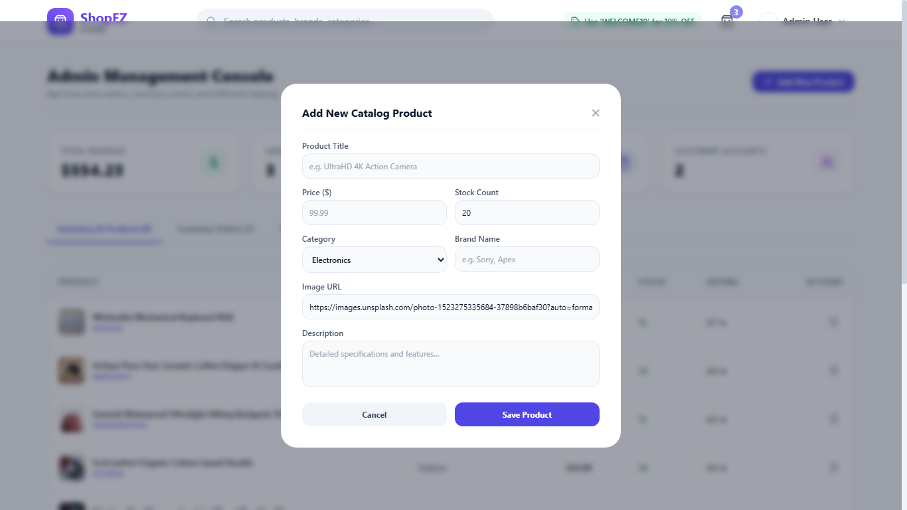 | 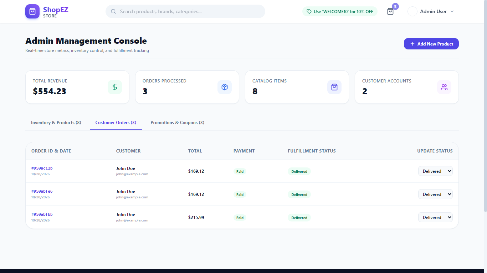 |

| 15. Responsive Mobile Storefront Layout (390×844) |
| :---: |
| 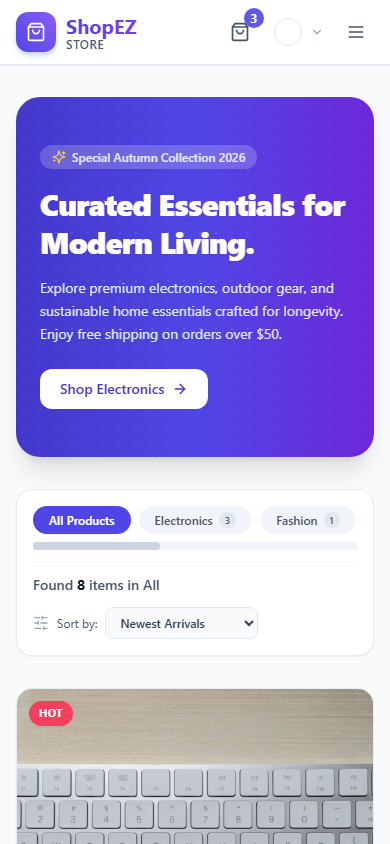 |

---

## 📡 REST API Documentation

### 🔐 1. Authentication & Profile (`/api/auth`)
| Method | Endpoint | Access Level | Description |
|:---|:---|:---|:---|
| `POST` | `/api/auth/register` | Public | Registers a new customer account with bcrypt password hashing |
| `POST` | `/api/auth/login` | Public | Authenticates credentials and returns signed JWT token |
| `GET` | `/api/auth/profile` | Authenticated | Retrieves current logged-in user profile details |
| `PUT` | `/api/auth/profile` | Authenticated | Updates customer delivery address and phone number |
| `GET` | `/api/auth/users` | Admin Only | Paginated list of registered store customer accounts |

### 📦 2. Product Catalog (`/api/products`)
| Method | Endpoint | Access Level | Description |
|:---|:---|:---|:---|
| `GET` | `/api/products` | Public | Queries catalog with keyword search, category, price, and sorting |
| `GET` | `/api/products/:id` | Public | Retrieves single product details, specs, and customer reviews |
| `GET` | `/api/products/top` | Public | Fetches top customer-rated products for home showcase |
| `GET` | `/api/products/categories` | Public | Distinct category list with item counts |
| `POST` | `/api/products` | Admin Only | Creates a new catalog product with image and stock specs |
| `PUT` | `/api/products/:id` | Admin Only | Updates product pricing, description, badge, or stock |
| `DELETE`| `/api/products/:id` | Admin Only | Deletes product from catalog |
| `POST` | `/api/products/:id/reviews` | Authenticated | Adds verified customer rating (1-5 stars) and review comment |

### 🛒 3. Order Management & Checkout (`/api/orders`)
| Method | Endpoint | Access Level | Description |
|:---|:---|:---|:---|
| `POST` | `/api/orders` | Authenticated | Creates order with server-calculated prices, coupon, and stock decrement |
| `GET` | `/api/orders/myorders` | Authenticated | Retrieves current authenticated customer's order history |
| `GET` | `/api/orders/:id` | Authenticated | Retrieves order receipt invoice (strictly restricted to owner or admin) |
| `PUT` | `/api/orders/:id/pay` | Authenticated | Updates order payment status to Paid with simulated transaction ID |
| `PUT` | `/api/orders/:id/status`| Admin Only | Updates fulfillment tracking status (`Processing`/`Shipped`/`Delivered`) |
| `GET` | `/api/orders` | Admin Only | Admin order ledger with status filters and customer details |

### 🏷️ 4. Promotional Coupons (`/api/coupons`)
| Method | Endpoint | Access Level | Description |
|:---|:---|:---|:---|
| `POST` | `/api/coupons/validate` | Public | Validates coupon code against minimum spend threshold and expiry |
| `GET` | `/api/coupons` | Admin Only | Retrieves all active and inactive store coupon codes |
| `POST` | `/api/coupons` | Admin Only | Provisions new promotional coupon code with discount percentage |
| `PATCH`| `/api/coupons/:id/toggle`| Admin Only | Toggles coupon active status |
| `DELETE`| `/api/coupons/:id` | Admin Only | Removes coupon from system |

### 📊 5. Analytics & Diagnostics (`/api/analytics` & `/api/health`)
| Method | Endpoint | Access Level | Description |
|:---|:---|:---|:---|
| `GET` | `/api/analytics/dashboard`| Admin Only | Aggregated store KPIs: Total Revenue, Orders, Products, Users, Low Stock |
| `GET` | `/api/health` | Public | Real-time health check reporting uptime and MongoDB connection state |

---

## 👨‍💻 Project Authorship & Capstone Submission

- **Student Developer:** **Gopal Jamadar**
- **GitHub Profile:** [@gopaljamadar70-sudo](https://github.com/gopaljamadar70-sudo)
- **Academic Course:** Final Year Capstone Project (B.Tech Computer Science & Engineering)
- **Repository URL:** [https://github.com/gopaljamadar70-sudo/ShopEZ-Ecommerce](https://github.com/gopaljamadar70-sudo/ShopEZ-Ecommerce)

---

<div align="center">
  <b>Built with ❤️ using the MERN Stack &nbsp;•&nbsp; Designed for Academic & Enterprise Excellence</b>
</div>
